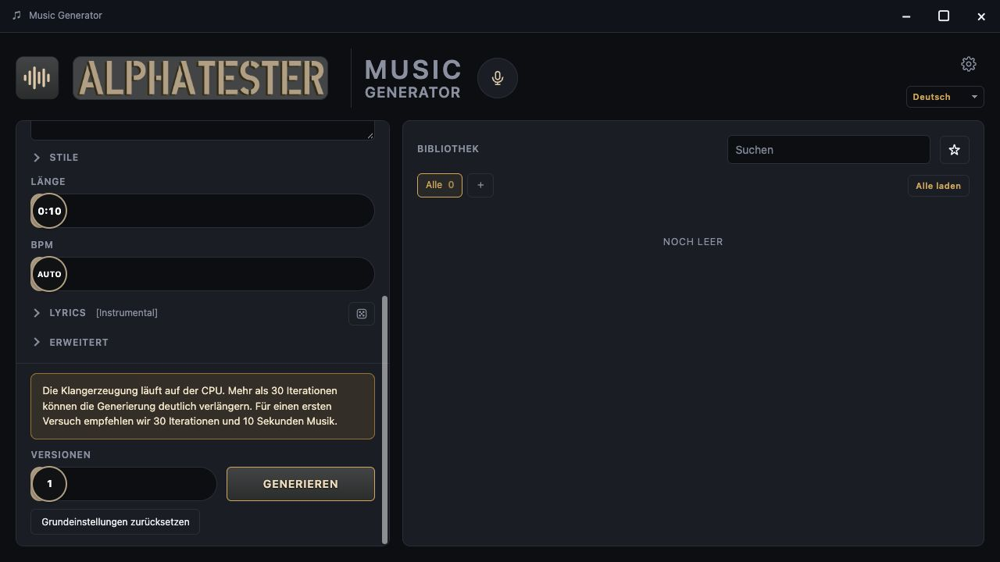
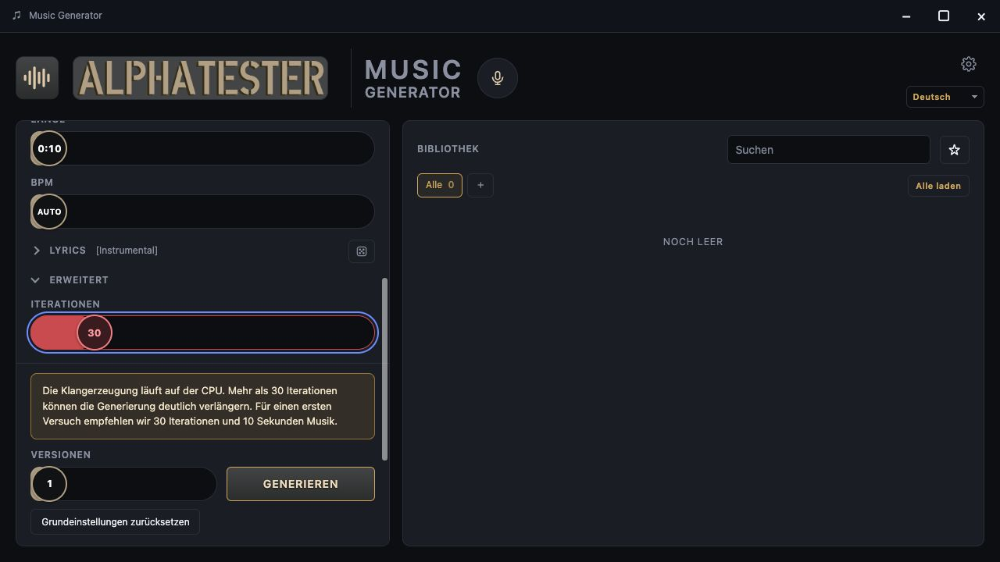
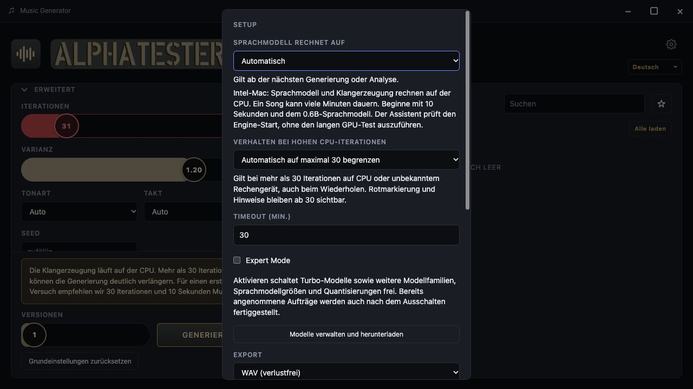
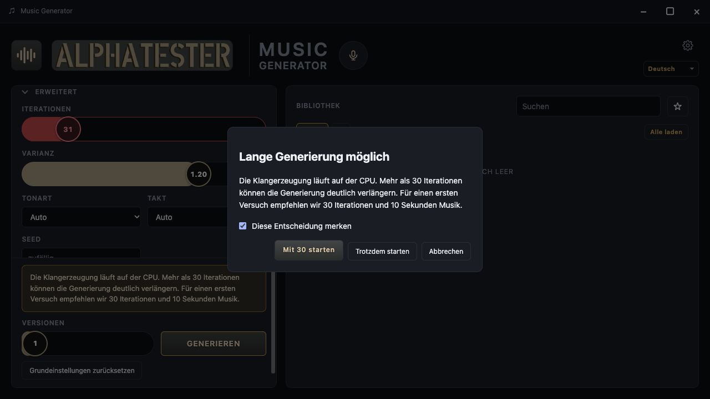
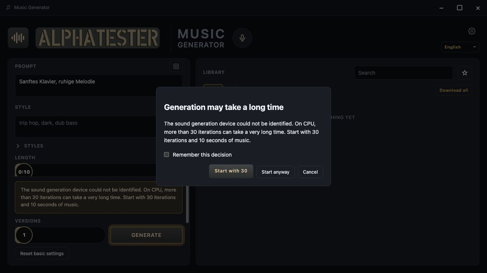

# CPU defaults and generation warning — issue #15

Sound generation on CPU, or an unknown synthesis device, uses at most 30 steps
as the fresh/reset default. Lower model recommendations (for example Turbo: 8)
remain lower. GPU synthesis keeps the catalog recommendation (Standard/XL: 80).
Saved form values and song snapshots are not migrated. Selecting a model does
not silently replace the user's steps.

The isolated, five-second GGML probe loads only the bundled runtime libraries,
using the same automatic backend initialization as the pinned synthesis engine.
It does not load model weights. CPU language-model selection is independent.
A failed or timed-out probe is `unknown`, never an assumed GPU. Preflight runs
again before each new generation or retry. A device/driver change between the
probe and actual execution cannot be ruled out; this is an advisory UX guard,
not a hardware reservation or a runtime estimate.

## Red slider and remembered behavior

At 30 steps the CPU/unknown slider fill, thumb and number turn red and the
single persistent hint becomes visible. Below 30 both disappear; on GPU neither
is shown. The confirmation starts only above 30.

The unchecked-by-default “Remember this decision” checkbox persists either
`limit_30` or `continue`. Cancel/Escape never store a choice. The settings selector
also offers `ask` to restore prompting. These preferences survive restart, apply
across models and retries, and can be changed during generation without an
engine restart or rewriting unrelated settings. With `limit_30`, reduction
happens at submission; the slider remains adjustable up to 200 and values below
30 stay unchanged. Red marking/hints remain independent of the saved behavior.
Save errors leave the dialog open and do not enqueue the request.

## Verification

- Frontend: TypeScript/Vite build, ESLint, Vitest (143 tests).
- Desktop scripts: 28 tests. Rust tests and Clippy with warnings denied.
- Real browser check using production studio markup/modules and mocked Tauri
  IPC: visible warning with Advanced collapsed, German CPU dialog with remember checkbox, exact 29/30 red boundary,
  remembered reduction on submission, retained high steps after choosing
  continue in Settings, Settings persistence after reload, reset to ask, and
  English unknown-device dialog. The screenshots below use simulated CPU/unknown
  policy responses; they do not claim a physical Intel or Windows test.
- Native helper initialized CPU using the existing macOS arm64 engine at
  source revision `b7ba6d9ce2f19ca7627fb8f340032c3ebe8ae253`, without model weights.
- Portable-bundle verification now initializes CPU through the new helper in
  each relocated package. The explicit CPU check loads only a compatible CPU
  module, using GGML variant scoring, without initializing optional GPU drivers. CI links and outcomes are recorded in the PR.

## Performance and listening acceptance still required

The original report measured **5:03 minutes for 10 seconds of music at 80
iterations on an Intel i5 Mac with 8 GB RAM and Standard + 0.6B**. This is a
reported baseline, not a measurement made for this patch.
Source: https://github.com/rabbitfiremediacreation/music-generator-desktop/issues/6

The local machine has an arm64 engine and Standard synthesis weights, but the
available ACE-Step language weights are 4B, not the requested 0.6B. No matched
30/50/80 generation or listening comparison was performed. Therefore this PR
makes no speedup or unchanged-quality claim. Physical Intel, Windows and Linux
acceptance remains open; CI startup checks do not replace it.

Use Standard Q8 + ACE-Step 0.6B Q8, 10 seconds, one instrumental variant, seed
42, temperature 1.2, prompt `Gentle solo piano, calm melody`, BPM Auto, identical
remaining parameters. Run 30, 50 and 80 steps on the same CPU, recording hardware,
OS, app/engine revisions, all request parameters, cold/warm model state, total
and synthesis time. Retain the audio for a listening comparison of artifacts,
coherence and prompt adherence. Also check an accelerated run with CPU-only LM
to confirm it keeps the GPU recommendation and does not show the CPU warning.

## Screenshots

Production UI with mocked device responses:

